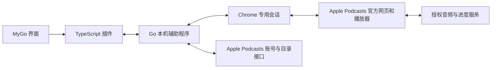

# 技术规格：Apple Podcasts for MyGo Music

版本：0.1 草案 · 日期：2026-11-10

需求基线：[PRD](PRD.md)。本文件给出推荐实施路线。登录和读取能力有实测依据，受保护播放、播放控制、双向写入和完整同步尚未验收。

## 1. 技术选型

| 部分 | 选择 | 目的 |
| --- | --- | --- |
| MyGo 插件 | TypeScript，strict 模式 | 定义宿主接口、资料模型、错误及能力契约 |
| 构建 | esbuild，输出单个 ESM `index.js` | 适配 MyGo 的 JS 插件入口，用户无需 Node.js |
| 本机辅助程序 | Go 1.25+；锁定 chromedp/cdproto 版本 | 管理官方 Chrome 会话、账号请求和播放控制，按平台提供二进制 |
| 浏览器与播放 | 已安装的正式 Google Chrome，专用持久化配置目录 | 使用苹果官方播放页处理账号授权和受保护音频 |
| MyGo 播放模式 | `remote` | MyGo 展示和遥控，Chrome 内的官方播放器实际出声 |
| 插件与辅助程序通信 | 仅本机 HTTP/JSON，随机端口、每次启动的会话凭证 | 不需要公网后端；插件不持有原始苹果令牌 |
| 存储 | Chrome 专用会话目录 + 按账号隔离的本地缓存 | 会话、缓存、待确认操作和同步游标分开保存 |
| 测试 | Node 内置测试、Go test、真实浏览器端到端验收 | 验证数据映射、失败恢复、真实同步与播放 |
| 发布 | GitHub 平台 ZIP、校验和、对应辅助程序 | 从 GitHub 安装，用户不需要编译环境 |

开发依赖首次安装时锁定确切版本，提交 npm 锁文件和 `go.sum`。规格不把未安装的版本号写成已经验证。若需修改 MyGo，宿主工具链按其 `go.mod` 单独确定；v0.1.22 要求 Go 1.27.3，不能与辅助程序的最低版本混淆。

Windows x64 为首个正式验收目标。代码保持跨平台边界，但 macOS/Linux 在实际测试前不声明可用。Edge、WebView2 和无界面 Chromium 的受保护播放不作为已验证替代品。

## 2. 为什么采用这条路线

纯 JS 插件配公开 RSS 适合免费节目，但无法单独证明会员音频播放。已有账号权限也不等于取得了可直接交给 MyGo 原生解码器的音频。

推荐让官方网页播放器保留授权、DRM 和进度上报流程。辅助程序遥控官方页面，并把播放状态返回 MyGo。这个方案的代价是运行时需要 Chrome 和一个本机辅助程序；能否稳定控制、在后台持续播放及同步进度，必须经过 G2/G3 验证。

MyGo 的播放模式是来源级选择，不能在设计中假设同一个 `stream` 来源能逐首切成 `remote`。因此首版统一采用 `remote`，免费和付费单集走同一控制链路。

若该路线验证失败，重新评审播放实现，保留 PRD 对付费播放和进度同步的要求，不直接降级为只读 RSS 插件。

## 3. 架构与职责



### 插件

- 导出 MyGo 能识别的账号、资料库、节目和遥控接口。
- 将 Apple 资料转换为 MyGo 的 `Show`、`Track`、`Browse` 和 `RemoteState`。
- 显示同步状态和可操作错误；不自行解析 DRM 或处理付款。
- 按需启动并探活辅助程序；不启动独立 Node/Python 运行时。

### 辅助程序

- 启动并控制专用 Chrome 会话，提供可见的官方登录页。
- 在内存中使用从该会话取得的账号凭据，只向匹配的苹果账号服务发送。
- 管理分页、缓存、写操作确认、账号隔离、队列和浏览器生命周期。
- 读取官方播放器的当前单集、位置、时长、播放状态与音量。
- 不把某次 UI 点击成功当作云端写入成功；写操作必须读回确认。

### Chrome 与官方页面

- 登录和验证码由使用者在官方页面完成。
- 播放器处理权限、受保护音频和官方进度上报。
- 使用专用目录，不附着使用者日常浏览器配置。优先使用 CDP pipe；若版本或平台必须用端口，则仅绑定本机临时端口。
- 不采用会禁用受保护媒体能力的启动参数。后台播放及自动播放策略必须实测，不靠无条件添加绕过参数假设通过。

## 4. 已有宿主接口与待补能力

MyGo v0.1.22 已有 `signIn`、`signOut`、`account`、`shows`、`show`、`subscribeShow`、`likeEpisode`、`liked`、`recent`、`browse`，以及 `remotePlay`、`remotePause`、`remoteResume`、`remoteSeek`、`remoteVolume`、`remoteState` 等接口。

计划映射：

| MyGo 接口 | Apple Podcasts 语义 |
| --- | --- |
| `shows` / `subscribeShow` | 已关注节目 / 关注与取消关注 |
| `liked` / `likeEpisode` | 已存单集 / 保存与取消保存 |
| `recent` / 自定义首页 | 平台收听数据 / 继续播放 |
| `show` / `search` | 节目单集 / 节目和单集搜索 |
| `remote*` | 官方网页播放器的实际状态与操作 |

`played({id})` 只通知单集开始播放，不携带持续播放位置。若使用原生 `stream`，不能据此完成精确进度回写；推荐的 `remote` 方案让官方播放器上报，避免把这个回调误用为进度接口。

但 `remote` 本身也不保证完整同步。仍须核实：云端位置的读取、主动标记已播放/未播放的操作入口、列表状态展示，以及队列在切集后与官方播放器的一致性。

如现有 MyGo 接口缺少必需 UI 或动作，提出最小的通用宿主扩展，例如单集完成状态、进度展示及标记动作。其名称和契约须经单独设计；它们不是当前已有 API。不得用只改标题或本地状态冒充平台同步。

MyGo 原生 ASR 依赖可读取的音频；`remote` 模式不能假设获得受保护音频。字幕优先研究官方转录接口，不承诺对付费音频进行本地 ASR。

## 5. 账号与接口

### 已验证的读取请求

目标主机为 `amp-api.podcasts.apple.com`：

- `GET /v1/me/storefront`
- `GET /v1/me/library/podcasts`
- `GET /v1/me/continue-playing/podcast-episodes`

实测通过官方网页登录取得 `media-user-token`，放入同名请求头，与官网开发者令牌配合即可在独立请求中读取数据。仅有公开目录令牌时，个人资料库请求被拒绝。

用户令牌不能与 `Music-User-Token` 头或其他 Apple 服务的会话直接混为一谈。开发者令牌从当前官网公开资源读取并缓存，不把会过期的 JWT 固定写进发布包。令牌到期、页面结构变化和会话失效分别处理；用户令牌不放入 URL。

### 待验证请求

关注写入/删除、保存写入/删除、已播放状态、独立播放位置、权益、频道及完整历史的具体方法、请求体和字段尚未确认。实施时依据官方网页真实行为记录接口，并用写后读回验证。不得从目录接口推导一个猜测的写接口后直接使用。

读取分页时只接受预期 Apple API 主机的 `next`，防止把认证头转发给节目托管商。资料库按稳定 ID 去重，并检测重复游标或“声称有下一页但返回空页”。

免费节目目录可使用 iTunes Search/Lookup；RSS 和公开音频不携带苹果账号凭据。若 RSS 网络不通，不把它解释成没有账号权限。

### 会话生命周期

`未登录 → 官方登录中 → 校验账号 → 首次同步 → 已连接`。

短暂网络失败进入可重试状态；确定的授权失效进入待重新登录状态，不能无限重试。退出时停止队列和同步任务，清理该账号的浏览器登录状态及私有缓存；不同账号的缓存命名空间分离。

## 6. 辅助程序通信契约（拟议）

以下为本项目内部 API，不是 Apple 官方 API：

| 操作 | 内部职责 |
| --- | --- |
| `health` / `capabilities` | 协议版本、浏览器状态、已验证能力 |
| `auth.start/status/signout` | 官方登录、状态确认和退出 |
| `library.refresh` | 刷新关注、保存、完成状态等资料 |
| `show.get` / `search` | 节目分页和搜索 |
| `follow.set` / `saved.set` | 带操作 ID 的显式状态写入与读回 |
| `completion.set` | 已播放/未播放的显式动作 |
| `player.play/pause/resume/seek/volume/state` | 队列和官方播放器控制 |

启动握手通过进程标准输入/输出传递临时端口和随机通信凭证，避免把苹果令牌写入命令行。后续凭证放请求头。服务只监听 `127.0.0.1`，拒绝跨站来源与非预期请求；接口路径不能接收任意浏览器脚本或任意目标地址。

响应统一包含 `requestId`、`ok`、`data` 或 `error`。错误区分 `signIn`、`setup`、`unavailable`、`unsupported`、`network`、`conflict`；日志仅保留动作、脱敏 ID、状态码和耗时。

## 7. 同步与播放规则

- 账号资料以服务端读回为准，本地保留最后成功快照。
- 关注、保存等操作按“账号 + 对象 + 状态”合并排队。超时但结果未知时先读状态，不能立即重复提交。
- 浏览器控制串行化，避免切集、定位和刷新互相覆盖；每次播放绑定单集 ID 和会话代次，丢弃上一集的迟到状态。
- 进入来源、回到前台、写操作完成和手动刷新触发拉取。限流时退避，不在每帧 UI 渲染中请求。
- 续播先取得苹果端最新已确认位置，完成加载后再定位。MyGo 队列恢复位置和云端位置的优先级必须覆盖主动从头播放、用户拖动和重启恢复三种不同动作。
- 官方播放器的进度上报是首选链路。需要证明暂停、拖动、切集、结束和正常退出后，其他设备可读回正确状态；`remoteState.position` 正确本身不等于云端已同步。
- 不使用“最大进度胜出”。主动倒退或标记未播放优先按显式意图处理。
- 离线期间只保留本机状态和待确认动作。重连先读云端；无法可靠比较进度先后时提示选择，不自动把旧位置覆盖到云端。
- 未拥有权益的节目返回准确权限状态；已有权益的节目由官方播放器处理授权。不得把公开预告、试看或试试听音频作为会员单集的成功结果。

## 8. 项目结构（计划）

```text
src/                    TypeScript 插件与 MyGo 类型定义
helper/cmd/             Go 程序入口
helper/internal/auth/   登录与账号状态
helper/internal/apple/  目录、资料库及写操作适配
helper/internal/browser/ Chrome 生命周期与官方播放器控制
helper/internal/sync/   缓存、操作队列与读回确认
helper/internal/server/ 本机通信协议
tests/                  脱敏样本与插件测试
scripts/                构建、打包和开发安装
locales/                中文等界面翻译
docs/                   PRD、规格与验证记录
plugin.json             可运行后加入的插件清单
index.js                发布时的单文件入口
```

当前仅提交设计文档，不放空壳 `plugin.json`，避免尚未可用的仓库被当成可安装插件。

## 9. 实施关卡

| 关卡 | 需要证明 | 通过后才能做的发布判断 |
| --- | --- | --- |
| G1 登录持久化 | 实际辅助程序登录、API 校验、退出、重启恢复、多账号隔离 | 账号接入预览可用 |
| G2 官方播放器控制 | MyGo remote 控制与队列、时长/位置、后台播放、免费完整音频、异常恢复 | 播放预览可用 |
| G3 进度与写入 | 关注/保存/完成状态双向同步；两台设备交替续播；异常冲突恢复 | 不能只凭列表读取宣布“完整同步” |
| G4 会员音频 | 有真实权益样本；DRM 官方播放、超试听长度、中段定位、跨端续播 | 会员播放通过 |
| G5 成品安装 | Windows x64 平台包、依赖提示、干净环境安装、正常退出清理 | PRD 全部必需项通过后发布正式首版 |

关卡失败应记录实际原因、影响需求和下一条验证路线。不能为了通过关卡删除必需需求。

## 10. 测试与发布

单元测试覆盖分页、数据映射、账号隔离、状态冲突、迟到事件、超时后的写结果判定，以及令牌/日志脱敏。真实测试覆盖官方登录、多端续播和账号已授权的会员单集。

测试素材使用合成或脱敏数据；Cookie、令牌、个人资料库及浏览器目录不进 Git。读写验收使用测试账号或明确选定、可恢复的测试对象，不对真实资料库批量操作。

GitHub 自动检查覆盖 TypeScript 类型、构建、Node 测试和 Go 测试。平台包包含入口、清单、翻译和对应辅助程序，不分发 Chrome。公开 README 标明预览/正式状态、运行依赖、已验收平台及仍未通过的关卡。

## 11. 参考依据

- [MyGo 插件协议与 remote 模式](https://github.com/egoist/mygo-music/blob/v0.1.22/README.md#plugins)
- [MyGo 播客和遥控适配](https://github.com/egoist/mygo-music/blob/v0.1.22/internal/plugin/source.go)
- [MyGo 资料模型](https://github.com/egoist/mygo-music/blob/v0.1.22/internal/music/music.go)
- [苹果关于公开 RSS 与受保护订阅音频的说明](https://podcasters.apple.com/support/5108-how-apple-podcasts-distributes-your-shows-to-listeners)
- [TypeScript](https://www.typescriptlang.org/docs/handbook/intro.html)、[esbuild](https://esbuild.github.io/getting-started/)、[Node 测试](https://nodejs.org/api/test.html)
- [chromedp](https://github.com/chromedp/chromedp)、[CDP](https://chromedevtools.github.io/devtools-protocol/)
- [Chrome 对专用调试配置目录的要求](https://developer.chrome.com/blog/remote-debugging-port)
