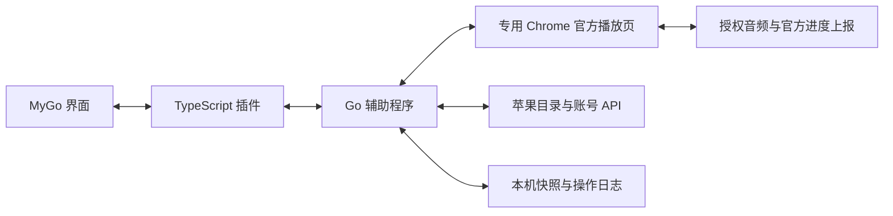

# 技术规格：Apple Podcasts for MyGo Music

版本：0.1.0-preview.1 · 日期：2026-11-10。需求基线见 [PRD](PRD.md)，实测范围见[验证记录](VALIDATION.md)。

## 1. 技术栈

| 部分 | 当前实现 |
| --- | --- |
| MyGo 插件 | TypeScript 7.0.2，strict；esbuild 0.28.2 输出单个 ESM |
| 辅助程序 | Go 1.25.0+；chromedp 0.23.0、cdproto 0.159.0 |
| 播放 | 正式 Chrome 专用持久化目录中的 Apple Podcasts / MusicKit 官方播放器 |
| 宿主模式 | MyGo 0.1.22 `remote`；位置/时长为毫秒，音量 0–100 |
| 通信与数据 | host.spawn + 本机 HTTP/JSON；Chrome 会话、展示快照、待确认操作日志 |
| 检查 | Node、Go、同版本 moejs 引擎和真实 Chrome 静音验证 |
| 发行 | 包含辅助程序的 Windows x64 ZIP；其他平台未验收 |

版本锁定在 npm 锁文件和各 Go 模块。MyGo 宿主的 Go 1.27.3 要求与辅助程序分开；用户安装无需编译工具。

## 2. 架构

官方播放器处理音频、授权和进度上报，MyGo 展示并遥控。播放模式为来源级配置；`played({id})` 不带位置，不能代替持续进度同步。

登录由用户在可见的官方页面完成。已登录时自动恢复会话并最小化 Chrome。最小化时的新音频加载及控制可能延迟，因此加载或控制时短暂展开，待操作完成再最小化。暂停和定位等待实际媒体状态确认；位置优先读取 HTML 媒体时间，避免仅依赖 MusicKit 的估计时钟。预览默认 `--mute-audio`，仅 `muteAudio=off` 开启声音。

CDP 通过管道，不开放调试端口。Windows 使用带 `KILL_ON_JOB_CLOSE` 的 Job Object，适配 MyGo 强杀辅助程序的退出行为。stdin EOF 时先关闭 RPC、暂停播放器、等待官方进度上传、关闭 Chrome。强杀只保证进程清理，不能保证最后进度上传。

## 3. 宿主映射

| 导出 | 语义 |
| --- | --- |
| account/signIn/signOut | 官方登录、API 校验及退出 |
| shows/subscribeShow | 关注列表和写入 |
| liked/isLiked/likeEpisode | 已存单集及保存/取消保存 |
| recent/home/browse | 继续播放、最新单集及同步页面 |
| show/search | 节目分页、节目/单集搜索、苹果分享链接 |
| remotePlay/Pause/Resume/Seek/Volume/State | 官方播放器的控制和真实状态 |

MyGo 没有原生完成状态字段，暂在 browse 单集状态页显示完成状态、云端位置，并提供标记、从头播放入口。后续需设计通用宿主扩展。频道界面与完整历史范围尚未完成。

MyGo 普通插件调用超时为 30 秒，登录为 5 分钟。大量分页、冷启动或慢速媒体可能超过普通时限，不能宣称解决了所有大资料库问题。

## 4. 苹果接口

认证仅发送至 `https://amp-api.podcasts.apple.com`。开发者令牌取自官网当前 MusicKit 实例；Cookie `media-user-token` 放入同名头，不替换成其他 Apple 服务的 Music-User-Token。

已观测并实现：

- GET `/v1/me/storefront`：登录校验和实际地区。
- GET `/v1/me/library/podcasts`、`podcast-episodes`、`podcast-channels`。
- GET `/v1/me/continue-playing/podcast-episodes`、`library/latest-episodes`。
- GET `/v1/catalog/{storefront}/search`、节目/单集详情，包含节目归属、单集、playback-position、权益数据。
- POST/DELETE `/v1/me/library/{podcasts|podcast-episodes}/{id}?platform=web`：关注/保存。
- PUT `/v1/me/playback/positions/podcast-episodes/{id}`：显式完成状态，属性为 completed、recordedAtTimestamp。标记未播放遵循官方语义，不强制把现有位置清零。

写接口来自官网前端实现，已在选定对象上写后读回。单集 playback-position 用于确认完成状态和毫秒位置。会员资源的 offers/权益交给官方播放器，尚未完成真实会员验收。

分页只接受精确的 API origin，不把认证头重定向到外部；去重、检测重复游标、空下一页和页数上限。音频 CDN/RSS 不携带账号头。响应正文、凭据与完整签名媒体地址不进入普通错误日志。

## 5. 本机协议

启动参数为 `--data-dir`、可选 `--chrome`、`--mute`。stdout 输出一行 `{protocol:1,url,token}`；端口随机且只绑定 127.0.0.1，凭证为随机 32 字节的十六进制。

POST `/rpc` 带 Bearer 凭证和 `{method,params}`；拒绝任何 Origin 请求，不接受任意脚本或任意目标地址。响应为 `{ok:true,data}` 或 `{ok:false,error:{code,message,pending?}}`，不返回苹果凭据。

| 方法 | 职责 |
| --- | --- |
| health | 协议/版本 |
| auth.status/start/signout | 会话、官方登录和退出 |
| api.get | 受限 GET、分页、展示快照 |
| library.set/completion.set | 持久化用户意图、写入和读回 |
| sync.status/retry/discard | 查看、明确重试或放弃待确认操作 |
| player.play/control/state | 队列/播放控制，单次最多 200 集 |
| window.show/diagnostics | 展开窗口和不含凭据的诊断 |

## 6. 同步规则

1. 先写本机操作日志，再请求苹果；服务端读回确认后才清除日志并向 MyGo 返回成功。
2. 关注/保存先读现状，超时后也读回，避免重复写入。同会话、对象、类型的操作合并，旧响应不能清掉新意图。
3. 不在后台自动重放旧写入。用户明确选择重试或放弃；重试前读最新状态。
4. 成功读取保留字段白名单过滤的展示快照，不缓存 offers、assetUrl 或认证字段。断网返回带时间的过期标记；失效登录和权限拒绝不能被旧缓存掩盖。
5. 播放前刷新首集权限/位置，默认云端续播；完成单集从头播放。明确定位优先，包括倒退；“从头播放”显式传 0，避免与默认续播混淆。
6. 官方播放器上传位置，另从账号 API 读回验收，不用最大进度覆盖主动倒退。切集、结束、应用退出、两台设备交替仍需完整回归。
7. 请求绑定授权会话指纹，账号变更时拒绝缓存或写入另一账号。指纹取用户令牌的截断 SHA-256，不保存原始令牌。令牌轮换会产生新命名空间，旧操作保留但不会自动迁移，这是预览限制。
8. 退出会调用官方 unauthorize 并清理当前指纹的快照/日志。自然到期、多账号实测、身份迁移及冲突选择界面未完成。

## 7. 实现目录与关卡

- src：插件、数据映射、宿主类型和辅助程序连接。
- helper/internal/apple、browser、syncstate、server、lifetime：API、官方播放器、状态持久化、RPC 和 Windows 生命周期。
- tests：合成样本、插件行为及同版本宿主引擎测试。
- scripts、locales、docs：构建安装、翻译、需求与实测记录。
- plugin.json / index.js：MyGo 发布入口；bin 和 dist 为忽略的构建产物。

正式首版仍须通过 PRD R01–R12。手机续播、会员音频、完整队列/退出进度、账号轮换、大资料库和干净环境未验收时，只能标记预览，不能用 API 或自动测试代替全部用户验收。

参考：[MyGo 协议](https://github.com/egoist/mygo-music/blob/v0.1.22/README.md#plugins)、[宿主](https://github.com/egoist/mygo-music/tree/v0.1.22/internal/plugin)、[资料模型](https://github.com/egoist/mygo-music/blob/v0.1.22/internal/music/music.go)、[Apple 音频分发](https://podcasters.apple.com/support/5108-how-apple-podcasts-distributes-your-shows-to-listeners)、[chromedp](https://github.com/chromedp/chromedp)、[moejs](https://github.com/MoeForge/moejs)。
