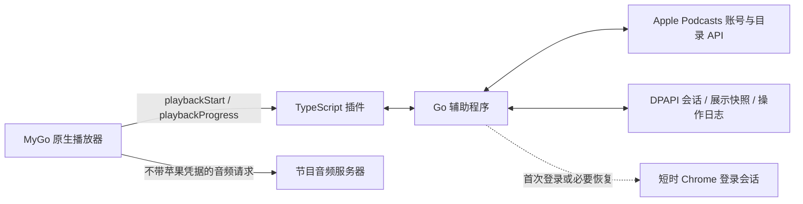

# 技术规格：原生播放与接口同步

版本：0.2.0-preview.1 · 2026-11-10。根据使用者要求，取代上一版常驻 Chrome 遥控播放的路线。

## 架构

辅助程序不包含播放命令，Chrome 登录模块不执行播放、暂停或定位。有效保存会话下，读取资料、返回音频和同步均不创建浏览器。

## 技术栈与宿主补丁

TypeScript 7.0.2 + esbuild 0.28.2，Go 1.25+ 辅助程序，chromedp 仅用于认证。Windows DPAPI 保存凭据。MyGo 宿主基于官方 0.1.22，构建需 Go 1.27.3。

宿主增加两个可选导出，未实现的来源行为不变：

| 导出 | 输入/输出 |
| --- | --- |
| playbackStart | `{id}` → `{position,context}`，播放前取得最新云端毫秒位置和不含凭据的账号上下文 |
| playbackProgress | `{id,position,duration,playing,completed,context,reason,recordedAt}`，接收实际原生播放器状态 |

`host.capabilities.playbackProgress=1` 表明宿主具备回调。宿主在暂停、定位、切集、结束、退出和播放中每 15 秒提交快照；后台按顺序投递并合并同对象的新意图。主线程不等待网络。退出前暂停原生音频，并给最终同步最多 8 秒，超时的已接收意图仍保留在辅助程序日志。

音频缓存与队列预取不充当续播数据。每次实际加载单集都单独调用 playbackStart；加载途中明确拖动的位置优先于迟到的云端结果。旧账号上下文的事件不能写入新账号。

## 持久登录

会话保存在 `session.bin`，用当前 Windows 用户 DPAPI 加密。原 `browser-profile` 保留以便静默恢复；从 0.1 导入一次后，正常启动只读加密会话。

账号状态在插件中缓存 45 秒，进入首页强制校验；同时进行的校验共享请求。Apple API 返回续发凭据时，仅更新发起该请求的同一会话，并保留经过该响应证明的账号标识。旧请求、退出前请求均不能覆盖新登录。

开发者 JWT 从官网公开配置更新，不写死在发布包中。超时、断网、429 和普通目录/权益失败不删除会话。仅 storefront 明确返回 401/403 时，最多每十分钟用原登录配置做一次无声恢复；候选凭据在账号接口确认前不覆盖已保存数据。

显式退出写入退出标记，并清空用户凭据，避免保留的旧浏览器目录在下次启动时自动接回。操作系统账户变更、苹果撤销授权或强制验证仍可能要求重新登录，不能承诺永久有效。

## 音频和 API

插件为 stream 模式，返回 Apple 目录中可直接播放的音频 URL。MP3/M4A/AAC/OGG/FLAC/WAV 由 MyGo 原生处理；格式不明时做不带 Cookie、Authorization、media-user-token 的短 Range 请求。受保护或未验证的分段格式明确失败，不回退到 Chrome，不用预告冒充完整音频。

认证头只发送到精确的 `https://amp-api.podcasts.apple.com`，拒绝带认证的外部重定向及越界分页。公开目录、账号列表、关注/保存/完成状态沿用已验证接口。原生位置使用 PUT `/v1/me/playback/positions/podcast-episodes/{id}`，包含毫秒位置、completed 与 recordedAtTimestamp，并从目录的 playback-position 读回。

## 同步与冲突

进度先落盘，再由后台上传；成功读回后清除对应操作。后到的旧响应不能清除较新的倒退意图。断网时保存最新有效状态；不在重启后盲目重放旧位置。

苹果 API 与本机时钟存在偏差时，使用受限 API 响应的 Date 和往返时间校正比较及写入时间戳，防止把自己的刚确认进度误判为另一设备更新。确认有较新云端进度时保留冲突，等待明确重试或放弃，周期回调不能静默覆盖冲突。

关注/保存/完成状态也写后读回。展示快照只保留白名单资料，不缓存媒体 offers、assetUrl 或原始认证字段；失效登录与权益拒绝不能被旧缓存掩盖。

## 网络地区与分页

实测同一有效会话在不同网络路由下会返回不同的资料库内容，外区节目也可能被跳转到中国区首页。不能把成功但经过地区过滤的响应直接视为用户取消关注。

辅助程序对公开站点做不带账号凭据的 HEAD 探测，地区主页结果缓存一分钟，首页或“我的主页”强制刷新时重查。关注列表有缺项时，还检查一个缺失节目的公开页面，避免仅因地区主页仍可访问而漏报。探测限制在官方域名内且有超时；未发现跳转并不保证不存在其他过滤。

确认地区跳转后返回上次成功的展示快照和明确标记，不覆盖该快照；没有快照时说明可能缺项。此时同步写入保留为待确认操作，不把地区隐藏的 404 当成成功。网络恢复后接受新的正常结果，包括真实取消关注；不会永久锁住旧列表。强制刷新同时关闭 API 空闲连接，避免沿用切换网络前的连接。

接口分页可能返回空 data 和有效 next，继续沿 next 读取；保留重复游标检查与 200 页上限。

## 内部 RPC

辅助程序仅监听 127.0.0.1 随机端口，每次启动随机 Bearer 凭证，拒绝 Origin 请求。接口包括 auth、api.get、media.stream、progress.start/record/flush、library.set、completion.set 和 sync.status/retry/discard。诊断只显示浏览器是否运行、是否保存登录和 API 时钟偏差，不暴露令牌。

## 参考和验收

参考设计见 [REFERENCE_DESIGN](REFERENCE_DESIGN.md)；实际证据见 [VALIDATION](VALIDATION.md)。正式需求仍以 [PRD](PRD.md) 为准，会员音频、真实手机交替续播、自然过期、多账号实测、长时稳定性与大资料库仍是发布关卡。
